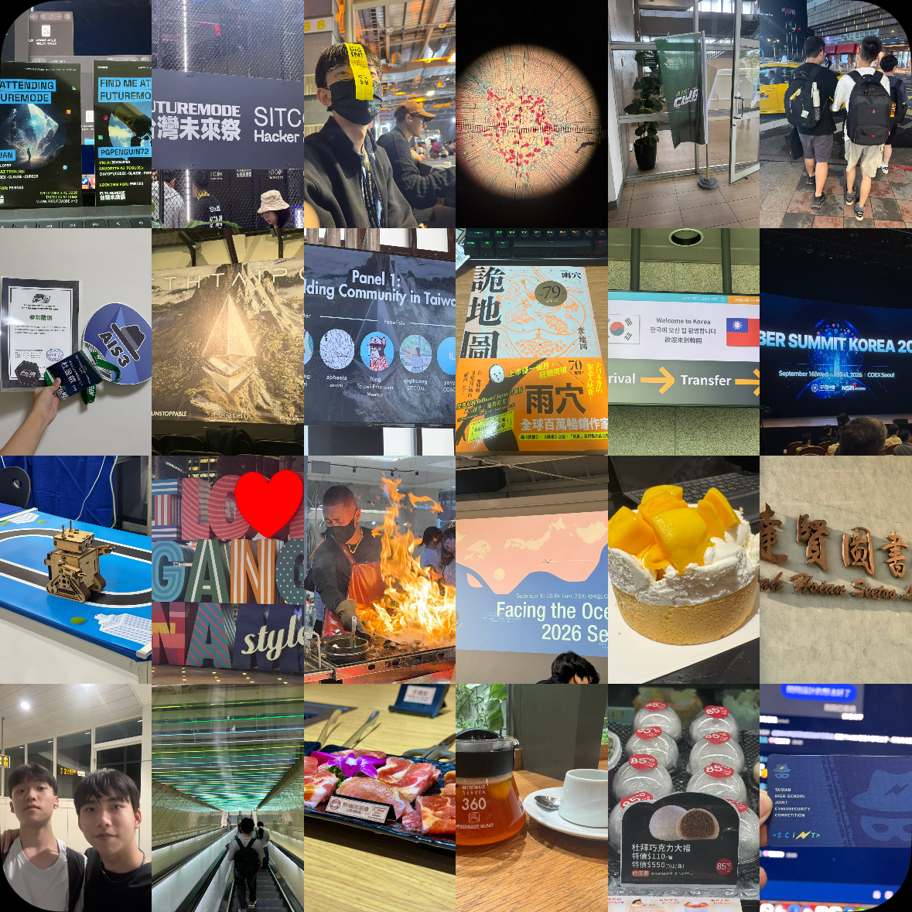
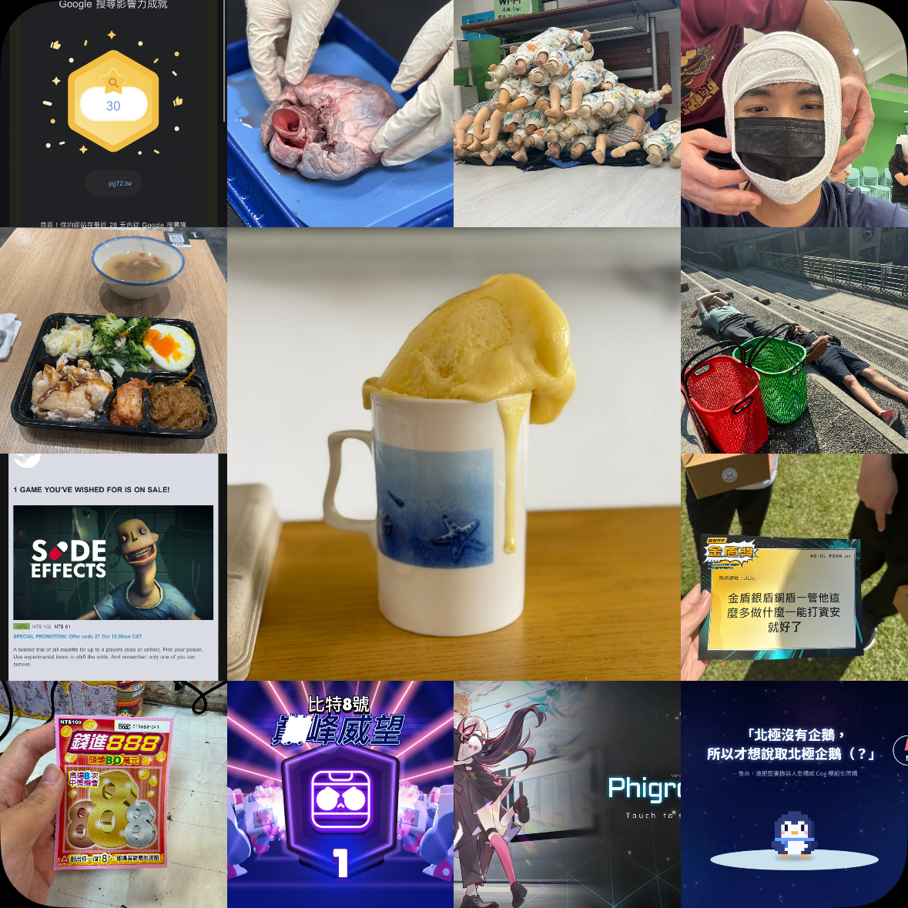

# 近況頁說明：
為什麼會有這篇文章（或是說這個頁面）呢？因為發現身邊好像有一些朋友也有更新，而且 `/now` 的理念是我把我最近專注的事情寫出來，然後讓讀者可以快速知道我最近在做什麼。

如果你更想了解 Now 的理念可以看這個網頁：
::link{url="https://nownownow.com/about" text="about nownownow.com"}  

然後我的期待是 1-2 個月更新一次這個頁面，然後我歷史寫的都可以在 [Archive](https://pg72.tw/archive) 的文章列表找到。

那廢話不多說，我就開始聊聊我的近況吧 \:D 

--- 

# 9月 - 10 月 的近況：
## 最近在幹啥？
- 📃 整理備審資料，投投看各校的特殊選才。
- 🎮 玩 Brawl Stars，被某個小孩帶入坑的。
- 💻 努力學競程，要準備去比北市賽和考 APCS。
- 🖊️ 整理並撰寫 Blog 文章，好多心得都還沒寫 QwQ
- 📝 準備模擬考ㄉ東西，雖然好像也沒怎麼在準備就是了。

## 最近參加的活動：
- 2026/09 FUTUREMODE 台灣未來祭 開發者會眾
- 2026/09 AIS3 教育部跨領域資通訊安全人才培育計畫 — 社團幹部訓練 台北場 學員
- 2026/09 ETHTaipei 2026 會眾
- 2026/09 CYBER SUMMIT KOREA 2026 與會者
- 2026/09 EdTech Korea Fair 2026 會眾
- 2026/09 Facing the Ocean Seoul 2026 參與者

## 最近參加的 競賽/能力檢定 ：
- 2026/09 BUILDMODE GEN-AI HACKATHON 2026
- 2026/09 115學年度第1學期校內數理暨資訊能力競賽(複賽) 二等獎
- 2026/09 中華電信 2026 智慧創新應用大賽
- 2026/10 115年度第21屆「資安技能金盾獎競賽」

## 你可以找我一起：
- 學習任何東西，不論是學科、資訊科技、還是各種酷酷的東西。
- 出去玩，不論揪吃飯或是玩樂，我可很喜歡出企玩的！（等學測倒數 50 天後就不要了吧，避免出事w）
- 打遊戲，可能找 tetr.io 或 荒野亂鬥這種線上的，反正我很爛（（
- 聊各種八卦、心事，我很樂意跟你聊喔！
- 做各種專案，但也要看我有沒有時間。

## 我最近的時間序：
8/31 開學ㄌ，我正式成為了一個高三正在準備的學測牲，雖然要學測ㄌ，但是我都在整理我的 Blog 文章，提前把特選資料整理一部分。

9/4-9/6，我去比了 FUTUREMODE x SITCON 的黑客松，但最近有億點點忙還沒寫下這篇 Hackathon 的心得，絕對不是有點懶哈w  
然後我在這個活動認識了 `吳鑽 Wuzuan` 和 `企鵝 Cheerawab`，然後我們就成為算不錯ㄉ朋友了！  
阿其他遇到啥事就等一下我的心得吧 \:D

9/12，我去參與了 `AIS3 教育部跨領域資通訊安全人才培育計畫 — 社團幹部訓練 台北場`，知道了 AIS3 可以提供經費，還有學習到了社群運營和 CTF 題目的出題。（一樣詳情等文章喔）。

9/13，我去參加 `ETHTaipei 2026`，聽了幾個有趣的議程，這篇好像有點懶不太想寫文章...

9/15 我比了校內程式競賽，拿了個二等獎，並獲得代表學校參與北市賽的資格。

9/16-9/20，我和我媽一起去韓國，我去參加資安研討會、黑客松，然後我媽幾乎自己玩自己的，因為我還未成年，而且韓國成年 19 歲，要不然我其實就可以自己去ㄌ。（等文章w）

10/3，我去參與 `BLS 基本救命術的實體課程`（基本上就是教如何進行 CPR、操作 AED、哈姆立克法、緊急包紮止血等基本急救方法，並進行實作），並獲取了證照。（文章w）

10/4 我才開始製作特選的備審資料公版，並且準備投稿師大和其他學校。

10/7 做了一個很酷的杯子蛋糕，下面好像還沒熟的樣子w

10/11 我正式加入了 NCSE 的社群贊助計劃小幫手，得到了 Claude Pro，然後我最近在玩用 Claude Opus 5.5 生成影片，超級好玩w

10/13-10/14 段考了，段考前我一直在整理一堆學校的備審資料，超級累 \:(  
啊我段考這次應該炸掉了，因為完全沒讀，那幾天甚至都凌晨 3:30 才睡，早上 7:00 起床，頭昏昏ㄉ

10/14 我把 [我的行事曆](https://calendar.pg72.tw) 正式完善了，可以預約和查看我的行事曆。（謝謝 Claude）

10/15 在某個小孩的帶領下正式入坑了荒野亂鬥（？

10/17 是大考第一次英聽，但由於我是上午場，會和金盾撞到，於是我就翹掉大考英聽去比金盾了。比金盾時遇到很多很有趣的事情，一樣等文吧ｗ

10/20 為 THJCC 拉到了 3000 元新台幣的贊助w

## 最近拍的照片合集：

:::note
如果對我的照片有興趣的話，可以去加我的 [Retro](https://retro.app/@pg_penguin_72) 喔！
:::

## 部落格文章預告：
- THJCC 總召去 AIS3 Club 社團幹部訓練...?
- Facing the Ocean Seoul 2026 心得 :D
- BLS 基本救命術？ 這到底是什麼？
- 金盾銀盾銅盾，管他這麼多做什麼？能打資安就好了！

## 結語
反正大概是這樣，最近真的好忙好忙，有的時候會不知道自己到底該幹嘛，就癱坐在那裡滑手機擺爛（就，也不是焦慮，而是那種大腦過載需要擺爛放鬆休息的感覺）。段考那段時間因為都熬夜，發布這篇 now 的這幾天我的時差還是沒調回來，也是挺頭疼的🤦  

反正最近事情很多，也就都快樂熬夜吧（誤

好啦認真說，最近雖然事情很多，不過我打算需要先把競程搞定，~~（因為讀段考學測沒未來）~~，然後再把升學的東西搞好這樣，感覺我應該是還撐得住。

好了！這就是最近的我！如果你覺得有什麼可以寫在 Now 的東西，歡迎在下方留言告訴我喔！