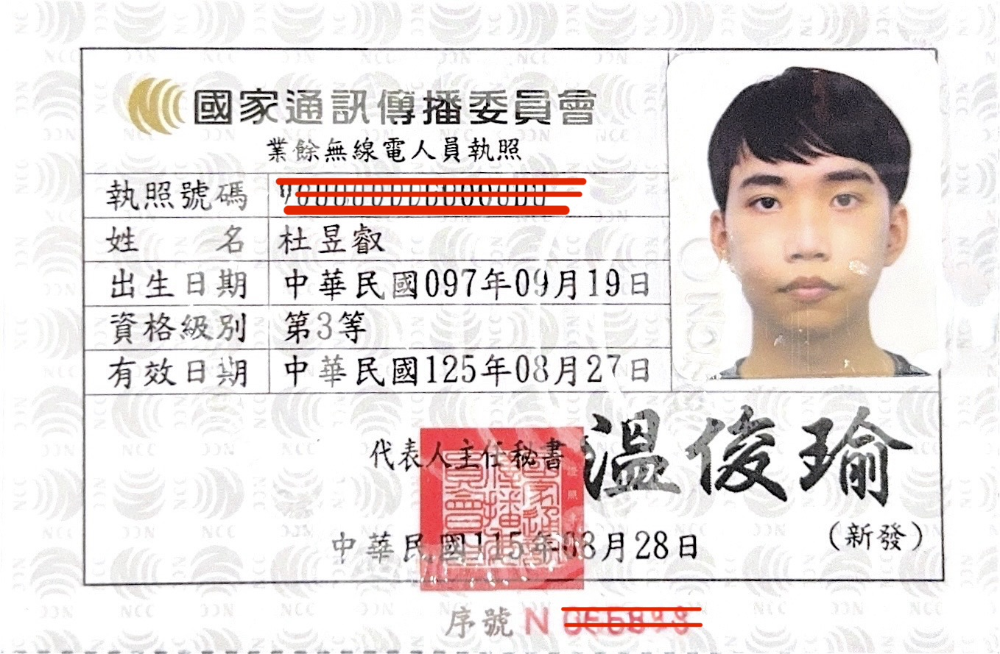
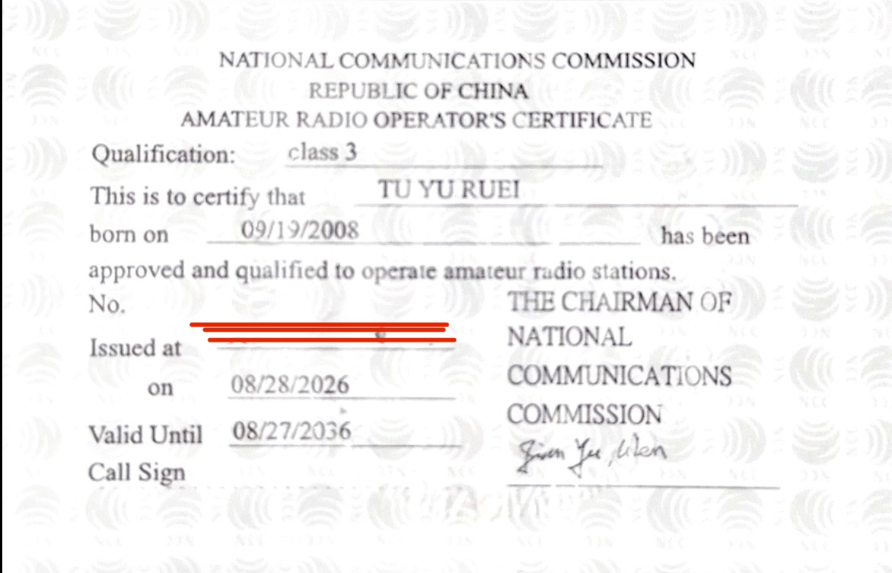

我：CQ，CQ，CQ，這裡是 BM2PCD，Bravo Mike Two Papa Charlie Delta，請問有人在嗎？

你：（訪問了網站，傳出了雜訊）

我：欸你好你好，我是 BM2PCD，不知道你是否可以聽清楚，但我還是想單方面分享我考業餘無線電執照的一些心得！

# 前言
一年前，2025 年的 6 月時，我看到了某篇 Blog 介紹了業餘無線電執照，我當時看到了覺得很有趣，於是我使用了 NotebookLM(現名 Gemini Notebook)把題庫資料丟進去，並邊做題目模擬考，並把結果傳回 NotebookLM，幫忙協助整理錯題及資料分析。

:::note
我做的真的沒有很好，但很歡迎互相友善的交流，或是也可以看看就好ㄌw
:::

::link{url="https://notebook.google.com/notebook/30b55cd0-6ee1-4d9a-a34c-499754d292de" text="業餘無線電人員三級證照 NotebookLM"}

不過這種衝勁往往都是三分鐘熱度，而且我也不知道我考了可以做啥，於是我大概做了 5 次後就懶得做了（（

在今年暑假的 SITCON Camp，我正式認識了 [淳](https://chuen666666.com)，他同時也有這個執照，我羨慕他有這個執照，於是在討論過後，我決定今年暑假就要有這份執照！

---

# 什麼是業餘無線電？
剛剛聽完我簡單說了一些前言，你還是對業餘無線電這個東西很陌生吧w

就讓我來告訴你一些基礎知識吧！

## 業餘無線電到底是在幹嘛？
簡單來說，我們生活中很多東西都需要用到無線電波，舉例來說：
- 服務業內部溝通
- 軍警消防的任務派遣
- 航空調度

這些都是常見的無線電波用途，這麼多地方都需要使用無線電波，但頻段資源非常稀缺，所以國際間有個聯盟「國際電信聯盟 ITU」協調了無線電各個頻段的用途，並制定一些國際基礎規則，然後再由當地主管機關（例如臺灣的數位發展部 及 NCC）制定相關規定。

但如果全部都給公部門或商業使用，那愛好者要怎麼辦？於是 ITU 就把一定的頻段給業餘無線電用。依照 ITU 對業餘無線電的定位，是讓經過授權的愛好者基於興趣，且不以金錢利益為目的進行通信與技術研究。

## 實際可以拿來做什麼？
和同好交流，研究無線電，在緊急狀況斷網斷電需要通訊時可以用到。

||~~還有一種用法是發現在跟朋友嘗試通訊時，使用了 `145.580` 附近的頻率，然後旁邊有 USB 設備，發射後導致 USB 設備異常。~~||

## 跟一般服務業常見的對講機有什麼不同？
最大的差異在於「功率」和「頻段」，概略來說，一般對講機通常不會超過 1 W，所以它的有效範圍很小。但業餘無線電（以三等來說）可以到 25 W，有效範圍最高可以到 10 km（以我這台來說）。  

:::note
下表由 Codex 協助生成進行比較。
:::

| 比較項目 | 臺灣低功率 FRS 對講機 | 業餘無線電 |
|---|---|---|
| 比較的重點 | 指定規格的低功率通信器材 | 有資格、電臺與作業規範的無線電活動 |
| 頻率 | 467.5125～467.675 MHz 中的 14 個指定頻道，不是範圍內任選 | 依資格等級、頻段及許可發射方式 |
| 功率例子 | 有效輻射功率 ERP 1 W 以下 | 三等相關頻段為 25 W 以下；實際操作仍受設備及電臺許可限制 |
| 數字如何比較 | ERP 是包含天線影響的輻射功率指標 | 管理辦法附表相關頻段採 PEP；不能直接把兩者當作相同量測值比較 |

## 為什麼需要考執照？
避免一群人在沒有相關知識時去玩，讓業餘無線電的頻段被長期不良佔用。

## 人員執照、電臺執照與呼號
依臺灣現行相關法規來說，我們無線電人員執照和電臺執照分別分成 1、2、3 等，1 等最高，3 等最低。

人員執照只能操作該等及以下等第的電臺，電臺會依照發射功率和頻率不同會有不同的規定。

呼號就像是這個操作者的「識別證」，你使用業餘無線電時需要報出呼號才能識別你是誰。

以我自己的呼號來說，`BM2PCD`，它是這樣拆的：
- B：臺灣法規規定的第一字元。（例如中國也是 B，日本有 J，英國有 M...etc）
- M：第二字元，臺灣優先使用 M、N、O、P、Q、U、V、W、X。
- 2：代表電臺所在地是臺北、新北，詳細可以去查表找一下ㄛ
- PCD：隨機的三個字母，反正是主管機關指配的字母，自己不可以選擇，如果是一等的話會只有兩個字母；二等一樣是三個字母，但第二字元會是 X（例如 BX2XXX）。

| 數字 | 電臺所在地 |
|---|---|
| 0 | 臨時電臺 |
| 1 | 基隆、宜蘭 |
| 2 | 臺北、新北 |
| 3 | 桃園、新竹 |
| 4 | 苗栗、臺中 |
| 5 | 彰化、南投、雲林 |
| 6 | 嘉義、臺南 |
| 7 | 高雄 |
| 8 | 屏東、臺東、花蓮 |
| 9 | 臺灣本島以外地區 |

大概是這樣，還有其他規定例如特殊業餘電臺、中繼電臺、臨時電臺，但我好懶，就不在這裡一一解釋了。

## CQ、73 是什麼？
業餘無線電愛好者有一些術語，例如 CQ（代表呼叫任何電臺，聽到的人都可以回應），73（代表祝福、問候，也就是 Best regards，通常在通聯結束時說）等，這裡我就不多做贅述，畢竟我也還沒有很清楚全部術語w

---

# 備考
## 考試資訊（三等）
- 報考地點：NCC 北區、中區、南區監理處（臺北、臺中、高雄），花蓮地區需先電話預約。
- 報考時間：每週一、五的 9:00-11:20 及 14:00-16:20 現場報名，隨到隨報；每週三採預約（團體優先），逢假日不舉辦。
- 題目樣式：使用電腦選擇題測驗，共 35 題單選題。
- 通過規範：於 40 分鐘內做完 35 題單選並至少答對 25 題即可通過測驗。
- 重考規定：當天沒過可以再加考 1 次，但要再繳一次考試費。

::link{url="https://www.gov.tw/News_Content_2_530779" text="業餘無線電人員資格測試（我的E政府）"}

:::tip
官方題庫 PDF 的最後一頁也附有《業餘無線電人員資格測試須知》，內容如有變更以 NCC 網頁公告為主。
:::

## 要準備的東西
### 報考和申領人員執照要帶什麼？
- 身分證
- 1 吋照片（最近 3 個月內，申請人員執照用）
- 現金 / 信用卡
    - 200 元考試費
    - 500 元業餘無線電人員執照費

### 驗機和申領電臺執照要帶什麼？
- 身分證
- 業餘無線電執照
- 無線電（具有 NCC 認證的業餘無線電）
- 現金 / 信用卡
    - 100 元驗機費
    - 500 元業餘無線電臺執照費
- [電臺設置申請書](https://api.ncc.gov.tw/chncc/app/data/doc?id=994&module=egov&detailNo=1451051571231068160&serno=1086&type=s&preview=undefined&aplistdn=undefined)（這個可以到現場後他會教你填寫）
- 家長同意書（未成年一定一定要寫）

:::warning
我朋友未成年，當天沒帶家長同意書，後來請家人線上電子簽好後列印出來才順利申請。  
所以記住未成年至少備著家長同意書，比較保險。
:::

## 考試前 1-3 天
我大概是在考前兩三天才開始準備複習，一開始我把題庫的所有題目都列印下來，每題都看過一次，有基本的記憶印象。

::link{url="https://api.ncc.gov.tw/chncc/app/data/doc?id=994&module=egov&detailNo=1554416768263393280&serno=1084&type=s&preview=undefined&aplistdn=undefined" text="三等業餘無線電題庫"}

題目大概分成六類，請參考以下表格：

| 題組 | 題庫題數 | 出題數 |
|---|---|---|
| 無線電規章與相關法規 | 229 | 13 |
| 無線電通訊方法 | 132 | 13 |
| 無線電系統原理 | 145 | 6 |
| 無線電相關安全防護 | 36 | 1 |
| 電磁相容性技術 | 10 | 1 |
| 射頻干擾的預防與排除 | 18 | 1 |
| **合計** | **570** | **35（至少答對 25 題）** |

接下來我就開始去寫模擬考，不過我覺得它的介面很難用，而且錯了我也不知道為什麼會錯。

::link{url="https://nccmember.ncc.gov.tw/exam/application/exam/examc07new.aspx" text="業餘無線電人員資格測試系統"}

在這個情況下，我覺得我應該要搞一個好用一點的模擬考網站，在跟 ChatGPT 規劃後，使用了 Codex 撰寫了程式，於是就有了這個：

::link{url="https://arl.pg72.tw/" text="業餘無線電備考所"}

這個網頁由於還沒有做完，只有開放給擁有 PGID 使用權的人可以登入註冊帳號，如果你有興趣使用的話歡迎聯繫我幫你開通帳號喔！

::link{url="https://pg72.tw/links" text="我的各種連結"}

然後刷了兩天題目後，我就直接去考試了。

## 考試當天
### 出發與購機
8/27 當天，我大概中午才出門，我先在忠孝敦化站拍了一張一寸大頭貼，走去光華買了一台業餘無線電，然後再去 NCC 北區監理處（臺北市濟南路）考試+驗機，當然考試和驗機不需要同時一起做，但可以省得跑來跑去。

### 現場考試流程
考試前，你需要先去旁邊電腦填寫一下報考基本資料（就是報名），如果人多可以先抽號碼牌再去填。填完後他會叫號去櫃檯，會有工作人員協助你填寫確認資料，確認無誤後就可以直接到旁邊的試場考試。

這個考試好像沒有很嚴，以我經驗來說，在工作人員指引下坐到自己位置後，可以把個人物品背包放在桌子底下，好像帶著電子裝置在身上不會被說違反規則，但建議還是收到背包中，避免作弊嫌疑。

考完試後就可以馬上看到自己的成績，通過的話跟工作人員說一下，就可以直接拿著東西到櫃檯申領執照了。如果沒過，要先回櫃檯重新繳費，才能再考一次。

### 驗機與領取執照
執照領到後就會帶你去驗機，驗機會叫你帶著無線電到旁邊的機器，然後你需要把機器接上轉接器後接到他們的測試儀器上，然後他會讓你去調到指定頻率發射（你需要按下發射鍵給工作人員看儀器讀數，證明你的機器在合法範圍內），然後會讓你測兩次（一次 VHF、另一次 UHF）。

驗完機後工作人員就會讓你回到櫃檯並到旁邊去繳費，繳完費坐在那裡等一下就可以快樂拿到執照了！

反正我整個考試+領照大概花了 1 小時左右，不包含去光華買東西。

---

# 執照介紹
:::note
為了保護個資，我有使用 AI 橡皮擦工具清除掉敏感個資喔。
:::

## 人員執照

可以看到這上面有寫你的出生日期、等級、執照號碼、有效日期（十年）。

可以看到上面有你的等級、英文名、出生日期、執照號碼、發行日期、到期日...etc

## 電臺執照

照片佔用格

---

# 後記
考到之後，由於身邊沒有人有無線電，我就去找 淳 問問看要不要通訊，雖然我們之間相隔 10 km 內，但因為之間有山擋著，還有建築物，所以我們通訊都以失敗告終。

然後在 FUTUREMODE 的時候我讓 吳鑽 帶著業餘無線電，我們在場館內就這樣用得很開心w，也是體驗到了業餘無線電的好玩處。

未來我可能會想往二等跑，但應該是學測後了吧 🤔

那回到主題，三等業餘無線電執照是什麼？能吃嗎？

相信你看完這篇文章也得到了一定的知識，可能也會有興趣。

我覺得它可以去考，去嘗試看看，畢竟是新的領域新的圈子，有興趣就可以去玩玩看，而且它的門檻也不高，可以當作人生的第一張執照（？

那就這樣啦！這裡是 BM2PCD，Bravo Mike Two Papa Charlie Delta，很高興遇見你，下次見，73。
